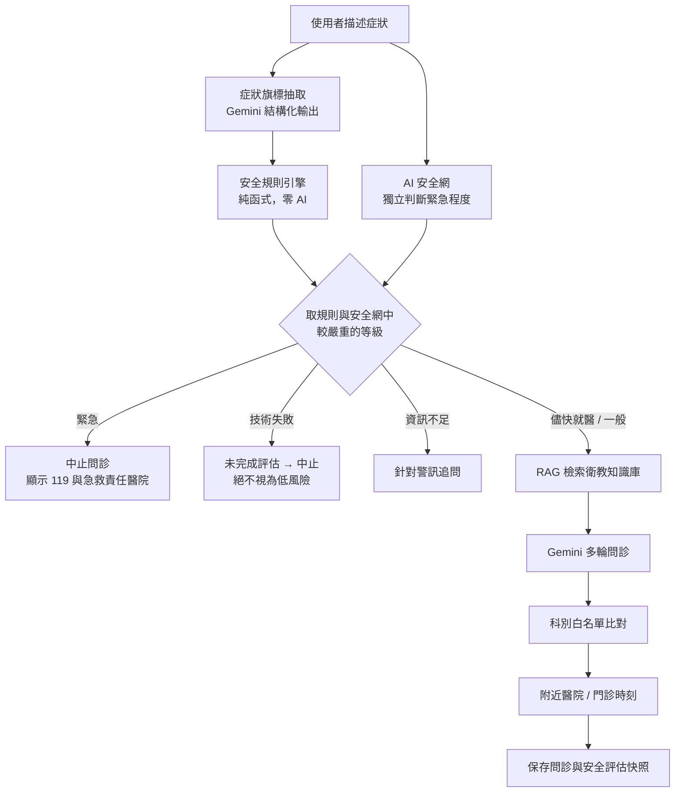

# CarePath AI

高齡智慧健康風險導航與就醫決策輔助系統。使用者用口語描述症狀，系統先做安全風險篩檢，再透過 Gemini 搭配衛教知識庫（RAG）多輪問診，建議就醫科別，並提供附近醫院、門診時刻、急症求助資源、就醫摘要與長期健康追蹤。

介紹影片：https://youtu.be/kQFzwhurcqo

> **本系統是就醫決策輔助與安全風險篩檢工具，不是疾病診斷系統，不能取代醫師診斷。** 系統列出的「可能原因」僅供參考；急需救護請直接撥打 119。

---

## 目錄

- [要解決的問題](#要解決的問題)
- [功能介紹](#功能介紹)
- [系統架構](#系統架構)
- [技術層級](#技術層級)
- [安全設計](#安全設計)
- [評測結果](#評測結果)
- [專案結構](#專案結構)
- [本機開發](#本機開發)
- [測試](#測試)
- [部署](#部署)
- [限制](#限制)

---

## 要解決的問題

身體不舒服時，多數人（特別是長輩）面對三個問題：

1. **該多快就醫？** 分不清該叫救護車、當天去看，還是可以等門診。
2. **該掛哪一科？** 掛錯科要重新掛號，延誤處理。
3. **去哪裡看？** 不知道附近哪家醫院有這一科、醫師什麼時候有門診。

一般的 AI 聊天機器人可以回答這些問題，但同一句話可能每次答案不同，也可能把「剛才手沒力、現在好了」這種疑似中風前兆判成不嚴重。CarePath AI 的做法是：**急症分級交給可稽核、可重現的固定規則，AI 只負責理解口語與蒐集資訊**。

---

## 功能介紹

### 1. 安全風險篩檢（每次問診第一步）

- 使用者每說一句話，系統都先檢查有沒有急症警訊（中風、高風險胸痛、嚴重呼吸困難、嚴重過敏、大出血、自傷意念等）。
- 結果分成三級：**緊急**（建議立即撥 119 或去急診）、**儘快就醫**（建議當天就醫）、**一般**（一般門診或觀察）。
- 判為「緊急」時立即中止一般問診，改顯示急症處置建議與附近急救責任醫院。
- 資訊不足以排除急症時，系統會針對關鍵警訊追問，例如使用者說胸痛，會追問有沒有喘、冒冷汗。
- **安全篩檢稽核紀錄**：每次判斷都能展開查看依據，包括命中哪條規則、規則版本、每個症狀是「明確有」「明確沒有」還是「沒提到」，以及使用者的原話。

### 2. AI 多輪問診

- 用口語描述症狀即可，系統會追問持續時間、部位、伴隨症狀等資訊。
- 問診時會檢索衛教知識庫（RAG），讓回答有醫療衛教資料依據。
- 會員可填寫個人健康檔案（身高、體重、生日、性別、過去病史、過敏史、目前用藥），問診時會一併參考。
- 支援**語音輸入**：網頁端使用瀏覽器語音辨識，行動端使用裝置語音辨識。辨識結果只填入輸入框、不會自動送出，使用者可以先修正再送出。

### 3. 科別建議

- 依問診內容建議就醫科別，並列出可能原因供參考。
- 建議的科別一定來自資料庫實際存在的科別清單；AI 給出清單外的科別時，系統會退回預設值，不會直接採用。

### 4. 附近醫院與醫師門診

- 依使用者定位或選擇的縣市，列出有該科別的附近醫院與距離，並在地圖上顯示。
- 涵蓋臺北、新北、桃園、臺中、臺南、高雄六都共 287 家醫院。
- 可查詢醫師門診時刻（目前為部分醫院的同步資料或人工匯入資料）。

### 5. 急症求助資源

- 判為緊急時，列出附近已核對的急救責任醫院（直線距離 30 公里內）與衛福部官方名冊連結。
- 名冊資料設有複核期限，超過期限就不顯示，避免提供過期資訊。

### 6. 就醫摘要

- 每次問診可產生一份就醫摘要（主訴、症狀經過、安全評估結果、建議科別），看診時可以直接給醫師看，減少口述遺漏。
- 摘要只讀取問診當下保存的安全評估紀錄，不會事後重新推論或改寫。

### 7. 長期健康追蹤（會員限定）

- **Dashboard**：問診次數、疼痛分數趨勢、常看科別、最近問診紀錄。
- **縱向健康分析**：同一症狀出現兩次以上才建立趨勢，也不會拿不同健康問題的疼痛分數互相比較，避免得出無意義的結論。
- **問診歷史**：可查看、重新命名、刪除過去的問診。

### 8. 長輩友善介面

- **長輩模式**：放大字體、按鈕與觸控範圍。
- 網頁端與行動端（Android APK）功能一致，行動端可以單獨使用。
- 訪客可直接試用問診功能，不用註冊；需要保存歷史的功能（健康檔案、縱向分析）限會員使用。

---

## 系統架構

### 問診流程



順序固定，**任何進入問診的路徑都必須先經過安全篩檢**。

### 三端架構

```
┌─────────────────┐   ┌──────────────────────┐
│ 網頁端           │   │ 行動端（Android APK） │
│ React + Vite     │   │ Expo / React Native   │
└────────┬────────┘   └──────────┬───────────┘
         │      HTTPS + JWT       │
         └───────────┬────────────┘
                     ▼
         ┌───────────────────────┐        ┌─────────────────┐
         │ 後端 FastAPI（Render） │ ─────▶ │ Google Gemini    │
         │ 安全管線 / 問診 / 推薦 │        │ 生成 + Embedding │
         └───────────┬───────────┘        └─────────────────┘
                     ▼
         ┌───────────────────────┐
         │ PostgreSQL + pgvector  │
         │ （Neon）               │
         │ 會員、問診、醫院、醫師、 │
         │ 衛教向量庫             │
         └───────────────────────┘
```

---

## 技術層級

### 各層技術

| 層 | 技術 | 負責 |
| --- | --- | --- |
| **呈現層：網頁** | React 19、Vite 8、Recharts、Google Maps JavaScript API、Web Speech API | 問診介面、地圖、Dashboard 圖表、語音輸入、稽核面板 |
| **呈現層：行動** | Expo SDK 57、React Native 0.86、react-native-maps、expo-location、expo-secure-store、expo-speech-recognition | 與網頁端相同的功能；定位、安全儲存登入憑證、裝置語音辨識 |
| **API 層** | FastAPI、Pydantic v2、Uvicorn | REST API、輸入驗證、三端共用的回應格式 |
| **身分驗證** | PyJWT、Argon2（pwdlib） | 會員與訪客登入、密碼雜湊、請求頻率限制 |
| **安全層** | 自建規則引擎（純 Python） | 33 條急症規則、三態症狀旗標、追問決策、版本與稽核紀錄 |
| **AI 層** | Google Gemini（google-genai SDK）、LangChain | 症狀旗標抽取（結構化輸出）、AI 安全網、多輪問診 |
| **知識檢索** | LangChain + PGVector、Gemini Embedding | 衛教文件向量化與檢索（RAG） |
| **資料層** | PostgreSQL（Neon）、pgvector、psycopg2 / psycopg3 | 會員、健康檔案、問診紀錄、安全評估快照、醫院與醫師資料、向量庫 |
| **部署** | Render（後端）、EAS Build（Android APK）、UptimeRobot | 自動部署、APK 打包、避免冷啟動 |

### 自然語言處理

自然語言理解都由大型語言模型（Gemini）完成。

| 任務 | 用途 | 實作 |
| --- | --- | --- |
| **資訊抽取** | 把「我爸右手拿不住筷子、講話含糊」轉成症狀旗標（單側無力：有、說話困難：有） | Gemini 結構化輸出，以 Pydantic schema 限制格式 |
| **否定與時序判斷** | 區分「沒有喘」（明確沒有）與沒提到；區分「剛才手沒力、現在好了」（曾發生、已恢復） | 三態旗標，加上「曾出現但已恢復」的獨立旗標 |
| **文本分類** | AI 安全網判斷緊急程度；依問診內容選擇科別 | Gemini，輸出限定在固定選項內，科別再比對白名單 |
| **語意檢索** | 依使用者描述找出相關衛教文件（RAG） | Gemini Embedding 向量化，pgvector 相似度搜尋 |
| **對話生成** | 多輪問診、追問、整理可能原因 | Gemini |
| **語音辨識** | 語音輸入 | 瀏覽器與手機內建的語音辨識服務 |

安全規則引擎刻意**不處理自然語言**，只讀症狀旗標：理解口語交給 AI，判斷交給固定規則，急症分級才能重現、才能交給醫療人員審閱。

### 後端 API

| 路徑 | 說明 |
| --- | --- |
| `POST /api/v1/auth/register`、`/login`、`/guest-login`，`GET /me` | 註冊、登入、訪客登入 |
| `POST /api/v1/diagnose` | 問診（安全篩檢 → RAG → 問診 → 科別 → 醫院） |
| `GET /api/v1/hospitals` | 附近醫院 |
| `GET /api/v1/doctor-schedules` | 醫師門診時刻 |
| `GET /api/v1/emergency-resources` | 急救責任醫院 |
| `GET /api/v1/visit-summary/{session_id}` | 就醫摘要 |
| `GET /api/v1/history`，`PATCH`/`DELETE /{session_id}` | 問診歷史 |
| `GET /api/v1/dashboard/summary`、`/pain-trend`、`/recent-sessions`、`/departments` | 健康 Dashboard |
| `GET /api/v1/longitudinal` | 縱向健康分析 |
| `GET`/`POST /api/v1/profile` | 個人健康檔案 |

完整規格啟動後端後見 `http://localhost:8000/docs`。

### 安全層模組

| 模組 | 負責 | 刻意不做 |
| --- | --- | --- |
| `symptom_flag_extractor.py` | 用 Gemini 把口語轉成 50 個症狀旗標（有／沒有／沒提到） | 不判斷風險 |
| `safety_engine.py` | 純函式規則判斷，同樣的旗標一定得到同樣的結果 | 不呼叫 AI、不讀自然語言 |
| `safety_llm_net.py` | AI 安全網：獨立判斷一次緊急程度 | **只能把等級往上調，不能往下調** |
| `safety_followup.py` | 決定要追問哪些警訊 | 只追問能改變判斷結果的問題 |
| `safety_pipeline.py` | 串起上面各模組、處理逾時與失敗 | 技術失敗不回「一般」 |
| `safety_observability.py` | 評估完整度、稽核欄位 | — |

---

## 安全設計

| 原則 | 做法 | 為什麼 |
| --- | --- | --- |
| **安全篩檢最先執行** | 問診流程固定順序，緊急就中止 | 不讓一般問診的 AI 有機會延誤急症 |
| **規則與 AI 分工** | AI 只把口語轉成症狀旗標，判斷交給固定規則 | 規則可稽核、可重現，可以交給醫療人員審閱 |
| **AI 安全網只能升級** | 規則與安全網取較嚴重者；安全網失敗時以規則為準 | 補上規則表沒涵蓋的急症，又不讓 AI 把規則判出的急症降級 |
| **失敗往保守方向倒** | 安全評估技術失敗時回「未完成評估」並中止 | 「沒有完成評估」不等於「沒有危險」 |
| **三態旗標** | 每個症狀分成「明確有」「明確沒有」「沒提到」 | 「沒提到」和「否認」是不同的事，壓成是非題會誤判 |
| **症狀消失不等於風險解除** | 「曾出現但已恢復」有獨立旗標 | 已恢復的中風前兆（TIA）仍需立即就醫 |
| **心理健康分層** | 有念頭 → 儘快就醫；有計畫或即將行動 → 緊急 | 依風險程度給不同強度的建議 |
| **版本即稽核軌跡** | 規則、抽取器、管線各有版本號，隨每次問診存入快照 | 事後能還原當時用的是哪一版規則 |
| **AI 輸出白名單** | 科別等 AI 產生的值必須比對資料庫清單 | AI 可能編造不存在的科別 |
| **單一規則隔離** | 每條規則個別捕捉例外 | 一條規則寫錯不會讓整個問診失敗 |

---

## 評測結果

評測腳本與案例在 [`backend/eval/`](backend/eval/README.md)。模型為 gemini-3.1-flash-lite；安全分級每案跑 5 次看一致性，比例附 95% Wilson 信賴區間。

### 安全分級：保留測試集（BMJ 2015 的 45 個標準案例，補規則時沒看過）

| 版本 | 急症偵測率 | 判太輕 | 完全正確率 | 5 次結果一致 |
| --- | --- | --- | --- | --- |
| 只有規則 | 40.0% | 37.8% | 57.8% | 100% |
| **規則 + AI 安全網** | **66.7%** | **13.3%** | **77.8%** | **100%** |
| 直接問 AI（對照組） | 66.7% | 13.3% | 77.8% | 95.6% |

### 安全分級：開發集（自編 200 筆）

| 版本 | 急症偵測率 | 判太輕 | 判太重 | 5 次結果一致 |
| --- | --- | --- | --- | --- |
| **規則 + AI 安全網** | **98.9%** | **1.5%** | 5.0% | **100%** |
| 直接問 AI（對照組） | 96.8% | 4.5% | 5.0% | 98.0% |

### 科別建議（自編 120 筆）

| 版本 | 命中率 | 給出不存在的科別 |
| --- | --- | --- |
| **CarePath（含 RAG）** | **95.8%** | 0% |
| 拿掉 RAG | 88.3% | 0% |
| 關鍵字對照 | 61.7% | 0% |

**解讀**：規則加 AI 安全網的準確度與直接問 AI 相同，差別在**穩定度**（同一句話每次結果都一樣）與**防降級**（直接問 AI 會把已恢復的疑似中風降級，規則層會擋住）。代價是部分「儘快就醫」的案例被判成「緊急」。

> 所有標準答案都是 AI 產生的候選標籤，正在請醫學系學生審閱；案例為虛構或改寫的情境，不是真實病人，評測結果不代表臨床效果。

---

## 專案結構

```
.
├── backend/        FastAPI 後端
├── frontend/       React + Vite 網頁端
├── mobile_app/     Expo（React Native）行動端
├── docs/           修正計畫與驗證紀錄
├── .claude/skills/ 團隊共用的 Claude Code skill（RAG 匯入流程）
└── render.yaml     Render 後端部署設定
```

### backend/

| 路徑 | 說明 |
| --- | --- |
| `main.py` | FastAPI 進入點，掛載所有 router |
| `routes/` | API 路由：`auth`、`diagnose`、`history`、`dashboard`、`hospitals`、`doctor_schedules`、`emergency_resources`、`longitudinal`、`profile`、`visit_summary` |
| `safety_*.py`、`symptom_flag_extractor.py` | 安全篩檢管線（見[安全層模組](#安全層模組)） |
| `consultation_prompt.py` | 一般問診的 prompt 組裝 |
| `longitudinal_intelligence.py` | 縱向健康分析 |
| `visit_summary.py` | 就醫摘要 |
| `emergency_resources.py` | 急救責任醫院查詢 |
| `services.py` | 資料庫、Gemini、RAG 等共用服務（含重試與降級） |
| `data/` | 醫院、急救責任醫院等靜態資料 |
| `schema/` | 資料表 schema 與套用腳本 |
| `ingest.py` | 將 `data/knowledge/*.txt` 衛教文件匯入 PGVector |
| `scrape_health.py`、`import_hospitals.py` | 衛教文件爬蟲、醫院資料匯入（離線工具） |
| `schedule_sync*.py`、`run_schedule_sync.ps1` | 醫師門診同步 |
| `eval/` | 安全分級與科別建議的評測腳本與案例 |
| `tests/` | 離線回歸測試（pytest） |

### frontend/src/

| 路徑 | 說明 |
| --- | --- |
| `SymptomChecker.jsx` | 問診主畫面 |
| `SafetyAuditPanel.jsx` | 安全篩檢稽核紀錄 |
| `HospitalMap.jsx`、`DoctorScheduleInfo.jsx` | 醫院地圖、門診時刻 |
| `EmergencyResources.jsx` | 急症求助資源 |
| `VisitSummaryPanel.jsx`、`LongitudinalHealthPanel.jsx` | 就醫摘要、縱向分析 |
| `pages/` | Dashboard、問診歷史 |
| `useSpeechInput.js`、`useElderMode.js` | 語音輸入、長輩模式 |
| `theme.js` | 樣式常數（不使用 CSS 框架） |

### mobile_app/src/

| 路徑 | 說明 |
| --- | --- |
| `screens/` | 登入、問診、Dashboard、歷史、個人檔案等畫面 |
| `components/` | 醫院地圖、門診時刻、急症資源、稽核面板 |
| `hooks/useSpeechInput.js` | 裝置語音辨識 |
| `context/` | 長輩模式等全域狀態 |

---

## 本機開發

### 環境需求

- Python 3.14
- Node.js（網頁端與行動端）
- PostgreSQL，需啟用 pgvector 擴充（正式環境使用 Neon）
- Gemini API 金鑰

三個子專案各有一份 `.env.example`，複製後填入實際值。`.env` 已被 `.gitignore` 擋住，不可 commit。

### 後端

```bash
cd backend
python -m venv .venv
.venv/Scripts/activate        # macOS / Linux：source .venv/bin/activate
pip install -r requirements.txt
cp .env.example .env          # 填入 DATABASE_URL、GEMINI_API_KEY、AUTH_SECRET_KEY
uvicorn main:app --reload --port 8000
```

啟動後可用 `http://localhost:8000/api/test` 確認連線，API 文件在 `http://localhost:8000/docs`。

### 網頁端

```bash
cd frontend
npm install
cp .env.example .env.local    # 填入 VITE_GOOGLE_MAPS_API_KEY；接本機後端時設 VITE_API_BASE_URL=http://localhost:8000
npm run dev
```

開發伺服器固定跑在 `http://localhost:5174`（Google Maps 金鑰的網址限制只放行這個 port）。

### 行動端

```bash
cd mobile_app
npm install
cp .env.example .env          # 填入 EXPO_PUBLIC_API_BASE_URL、GOOGLE_MAPS_ANDROID_API_KEY
npm start
```

APK 透過 EAS Build 打包（設定見 `mobile_app/eas.json`）；雲端建置不會讀本機 `.env`，需用 `eas env:set` 另外設定。

行動端語音輸入使用裝置的語音辨識服務，需允許麥克風與語音辨識權限。辨識結果只會填入問診輸入框，不會自動送出；裝置的辨識服務可能需要網路。新增或更新原生模組後須重新以 EAS 建置 App，Expo Go 不包含此原生功能。

### RAG 知識庫

衛教文件放在 `backend/data/knowledge/*.txt`，更新後重新匯入：

```bash
cd backend
pip install langchain-community   # ingest.py 專用，不在部署相依內
python ingest.py
```

詳細流程與格式見 [.claude/skills/rag-ingest/SKILL.md](.claude/skills/rag-ingest/SKILL.md)。

---

## 測試

後端離線測試（不連資料庫、不呼叫 Gemini）：

```bash
cd backend
pip install -r requirements-dev.txt
python -m pytest
```

安全模組有內建 smoke test，純規則、不呼叫 Gemini：

```bash
cd backend
python safety_engine.py
python safety_llm_net.py
```

評測（會實際呼叫 Gemini）見 [backend/eval/README.md](backend/eval/README.md)。前端瀏覽器回歸測試見 [frontend/tests/README.md](frontend/tests/README.md)，後端測試範圍見 [backend/tests/README.md](backend/tests/README.md)。

---

## 部署

後端部署在 Render，設定寫在 [render.yaml](render.yaml)：

- 服務根目錄為 `backend/`，只有 `backend/**` 或 `render.yaml` 變動才會自動部署
- `DATABASE_URL`、`GEMINI_API_KEY`、`GEMINI_MODEL_NAME`、`AUTH_SECRET_KEY`、`CORS_ALLOWED_ORIGINS` 需在 Render 後台手動填入
- 存活檢查指向 `/api/test`；`/api/health/db` 供外部監控定時呼叫，避免 Neon 閒置休眠
- 冷啟動後第一次 RAG 檢索需要較長時間暖機，展示前建議先送一次問診

---

## 限制

- 本系統是就醫決策輔助工具，**不做疾病診斷**，也未經醫療器材認證。
- 安全規則與評測標準答案尚未經執業醫師審閱。
- 科別建議目前限於資料庫內有醫師資料的 9 個科別；醫院資料涵蓋六都（臺北、新北、桃園、臺中、臺南、高雄）。
- 醫師門診時刻沒有全國性的開放資料，目前只涵蓋部分醫院。
- 急救責任醫院清單為部分已核對的院所，距離為直線距離。
